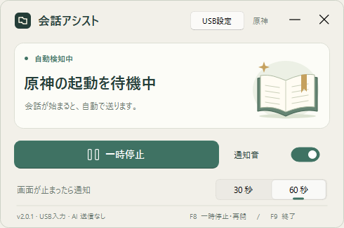

# 原神 会話アシスト / Genshin Dialogue Assist

日本語版の原神の会話をローカルの画像処理で検出し、会話中だけ **F** を送るWindows用アプリです。AI・APIキー・Pythonのインストールは不要です。

A Windows desktop app that detects dialogue in the Japanese Genshin Impact UI using local image processing, then sends **F** while dialogue is visible. The packaged app needs no AI service, API key, or Python installation.



## ダウンロード / Download

[Releases](https://github.com/part676392/genshin-dialogue-assist/releases) から `Genshin-Dialogue-Assist-v2.0.1-windows-x64.zip` を取得します。

1. ZIPを右クリックして **すべて展開**。`会話アシスト.exe` を起動します。
2. 初回だけ、右上の **USB設定** を押します。Windowsの管理者確認を許可してください。設定後はWindowsを一度再起動してください。自動では再起動しません。
3. アプリと原神を起動し、原神を前面にします。会話の検出・入力は自動です。

Download `Genshin-Dialogue-Assist-v2.0.1-windows-x64.zip` from [Releases](https://github.com/part676392/genshin-dialogue-assist/releases).

1. Right-click the ZIP and **Extract All**. Run `会話アシスト.exe`.
2. On first use, click **USB設定 / USB setup** at the top right and approve the Windows administrator prompt. Restart Windows once after setup; the app never restarts it automatically.
3. Open the app and Genshin Impact, then keep the game in the foreground. Dialogue detection and input are automatic.

初回設定は、同梱の署名済み `usbip-win2` と必要なVC++ランタイムを導入します。USB機器が一時的に再接続されることがあります。以後の通常動作はローカルのみです。実行ファイル自体にはコード署名がないため、Windowsが発行元不明と表示する場合があります。

First-time setup installs the bundled signed `usbip-win2` package and its VC++ runtime prerequisite. USB devices may briefly reconnect. Normal operation is local. The application EXE itself is unsigned, so Windows may show an unknown-publisher notice.

| 操作 / Action | キー / Key |
|---|---|
| 一時停止・再開 / Pause or resume | F8 |
| 終了 / Quit | F9 |
| 会話・認識した選択肢を進める / Advance detected dialogue and choices | F, 250 ms interval |

会話終了・別アプリへの切り替え・最小化で入力を止めます。マウスを動かしたり、カーソルの範囲や表示を変更したりしません。画面の進行が30秒または60秒止まると、一度だけ通知できます。

Input stops when dialogue ends, another app becomes active, or the game is minimized. The app does not move, confine, or hide the mouse cursor. An optional one-shot alert reports 30 or 60 seconds without progress.

## 対応範囲 / Scope

- Windows x64、16:9、日本語版の通常会話UI。/ Windows x64, 16:9, standard Japanese dialogue UI.
- 選択肢の内容を理解せず、Fで決定します。/ Choices are confirmed with F; their meaning is not interpreted.
- スキップ不可の演出を強制終了する機能ではありません。/ Unskippable scenes remain unskippable.
- 会話画面を外部へ送信・保存しません。/ Game frames are neither uploaded nor saved.
- このプロジェクトはHoYoverseの公式・公認ソフトではありません。特定入力方式のBANリスク低下や不可検知性を保証しません。/ This is an independent, unofficial project. It makes no claim of anti-cheat invisibility or reduced account-ban risk.

## 入力間隔 / Input interval

v3.0.1の「入力間隔」は「一定」と「ランダム」を切り替えられます。「一定」ではスライダーで350～500msを1ms単位で設定できます。「ランダム」では送信ごとに350～500msから間隔を選び、この間は固定値用のスライダーを無効にします。初期設定はランダムで、選んだ設定を次回起動にも引き継ぎます。処理負荷や画面遷移によって実際の送信間隔は長くなることがあります。ランダム化による検知回避は保証しません。

v3.0.1 lets you select Fixed or Random under Input interval. Fixed uses a slider from 350 to 500 ms in 1 ms steps. Random samples a new interval between 350 and 500 ms for each dispatch and disables the fixed-value slider. Random is the initial mode, and settings persist across launches. Processing load and screen transitions may lengthen actual dispatch intervals. Randomization does not establish detection avoidance.

「会話待機中」にはFを送りません。会話または選択肢を連続確認し、送信直前も会話コントロールがある場合だけ送ります。送信前に会話が消えた場合、入力を取り消して待機表示へ戻ります。押下後のキー解放は必ず行います。

No F is dispatched while waiting for dialogue. Dispatch requires repeated dialogue or choice confirmation and another control check immediately before input. If dialogue disappears, dispatch is canceled and the UI returns to waiting. Each submitted key-down is followed by release.

## v1 / Original version

`v1.0.0` は既存の `2026.09.28.4` の公開保存版です。Windowsの `SendInput` を使用し、管理者として動くゲームへ送るためWindowsの管理者確認が表示されます。

`v1.0.0` archives the original `2026.09.28.4` application. It uses Windows `SendInput`; Windows requests administrator permission to match an elevated game.

## v2 / USB keyboard version

v2は、未改変の **libVIIPER 0.8.1 + usbip-win2 0.9.8.1** で独立した仮想USB HIDキーボードを作ります。USB/IPの待ち受け先は **127.0.0.1のみ**です。入力はFの押下・解放だけで、接続に失敗した際に旧方式へ自動で切り替えることはありません。終了時にキーを解放し、仮想キーボードを切断します。

v2 creates a separate virtual USB HID keyboard with unmodified **libVIIPER 0.8.1 + usbip-win2 0.9.8.1**. The USB/IP listener binds to **127.0.0.1 only**. It sends only F down/up and does not silently fall back to the old transport if connection fails. On exit, it releases the key and disconnects the virtual keyboard.

| バージョン / Version | 入力方式 / Transport | 初回設定 / Setup |
|---|---|---|
| [v1.0.0](https://github.com/part676392/genshin-dialogue-assist/releases/tag/v1.0.0) | Windows SendInput | 追加ドライバーなし / No extra driver |
| [v2.0.1](https://github.com/part676392/genshin-dialogue-assist/releases/tag/v2.0.1) | Virtual USB HID keyboard | 同梱ドライバー / Bundled driver |

**v2.0.1の修正:** v2.0.0では「USB設定」で再接続すると、仮想USBバスの解放漏れにより「仮想USBバスを作成できませんでした」と表示される不具合がありました。管理者権限の問題ではなく、v2.0.1で切断処理を修正しました。画面左下のバージョンで確認できます。

**v2.0.1 fix:** v2.0.0 could fail with “Cannot create virtual USB bus” after reconnecting through USB setup because a bus allocation was not released. This was a teardown bug, not an administrator-permission issue. v2.0.1 fixes cleanup and displays the exact version at the bottom left.

Sunshine/MoonlightでのHoYoverse作品の利用報告はありますが、このv2のドライバー構成をHoYoverseが承認した証拠はありません。物理USB機器と識別不能にする実装ではありません。調査の出典と区別は [入力方式の調査 / Input research](docs/INPUT_RESEARCH.md)、検証範囲は [検証結果 / Validation](docs/VALIDATION.md) に記載しています。

Community reports show HoYoverse games being played through Sunshine/Moonlight, but they do not establish HoYoverse approval of this v2 driver stack. This implementation does not make a virtual device indistinguishable from physical hardware. See [Input research](docs/INPUT_RESEARCH.md) for sources and [Validation](docs/VALIDATION.md) for the actual test scope.

## 開発 / Development

```powershell
py -3.13 -m venv .venv
.\.venv\Scripts\python.exe -m pip install -r requirements.txt
.\.venv\Scripts\python.exe tools/fetch_vendor.py
.\.venv\Scripts\python.exe -m unittest discover -v
.\.venv\Scripts\python.exe -m PyInstaller --noconfirm --distpath dist 会話アシスト-配布用.spec
```

実際のプレイヤー画面を含む回帰テスト画像は公開しません。所有している画像で検証する場合は `GENSHIN_TEST_FIXTURES` に画像フォルダーを指定してください。画像なしでも公開の単体テストを実行できます。

Private gameplay regression screenshots are excluded from the repository. To run those tests with your own fixtures, set `GENSHIN_TEST_FIXTURES` to the fixture directory. Public unit tests can run without those screenshots.

設定と状態は `%LOCALAPPDATA%\GenshinDialogue` に保存されます。公開ZIPへ個人設定を同梱しないでください。

Settings and status live in `%LOCALAPPDATA%\GenshinDialogue`. Do not include your personal settings in redistributed ZIPs.

`--observe-only` は検出だけ、`--preview` はUIの確認だけを行います。開発者向けの `tools/probe_keyboard.py <result.json>` は専用画面に12回だけFを送り、Raw Input受信を確認します。テスト画面からフォーカスが外れると中止します。

`--observe-only` detects without input; `--preview` displays only the UI. For developers, `tools/probe_keyboard.py <result.json>` sends 12 F taps to its own test window and checks Raw Input reception. It aborts if that window loses focus.

## 削除 / Uninstall

アプリを終了して展開フォルダーを削除します。ドライバーも不要になった場合は、Windowsの「インストールされているアプリ」で **USBip** をアンインストールしてください。他のUSB/IP利用アプリで使っている場合は残してください。

Quit the app and delete its extracted folder. If no other application needs USB/IP, uninstall **USBip** through Windows Installed Apps. Keep the shared driver if another application uses it.

## ライセンス / License

アプリのコードはGPL-3.0です。依存ソフト・ゲームのUI素材の権利はそれぞれの権利者に帰属します。[THIRD_PARTY_NOTICES.md](THIRD_PARTY_NOTICES.md) を参照してください。

Application code is licensed under GPL-3.0. Dependencies and game UI material retain their respective licenses and ownership. See [THIRD_PARTY_NOTICES.md](THIRD_PARTY_NOTICES.md).

## v3.0.1 待機時の点滅修正 / Waiting flicker fix

画面取得のCAPTUREBLTを無効にし、SRCCOPYのみを使用します。F送信0回でも画面取得が点滅を起こす可能性を、入力の不具合と分けて扱います。待機表示は「会話を探しています · F送信停止」で、累計送信回数と最終送信時刻も表示します。入力前に表示を更新し、その後に会話コントロールと送信許可を再確認します。

Screen capture uses SRCCOPY without CAPTUREBLT, addressing the fullscreen flicker reported in [python-mss issue #179](https://github.com/BoboTiG/python-mss/issues/179). Waiting explicitly displays that F dispatch is stopped, with a cumulative dispatch counter and last dispatch time. The panel is painted before input, followed by a fresh dialogue-control and authorization check.
